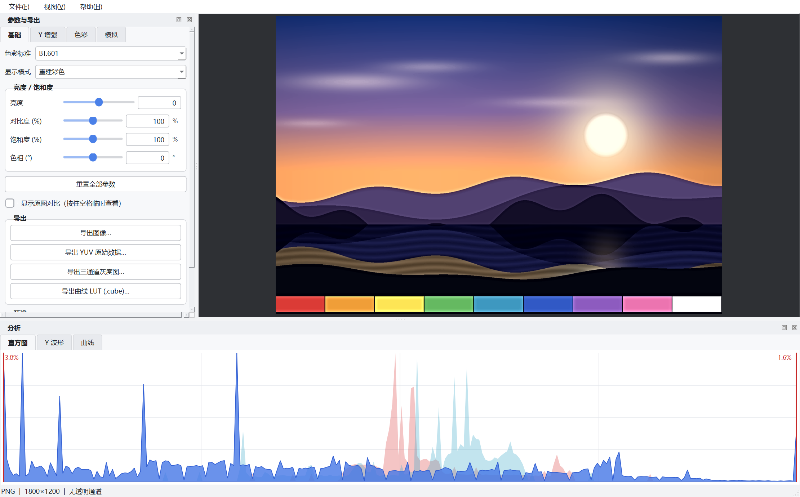
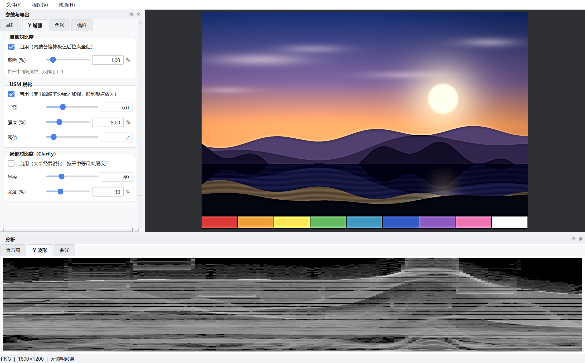
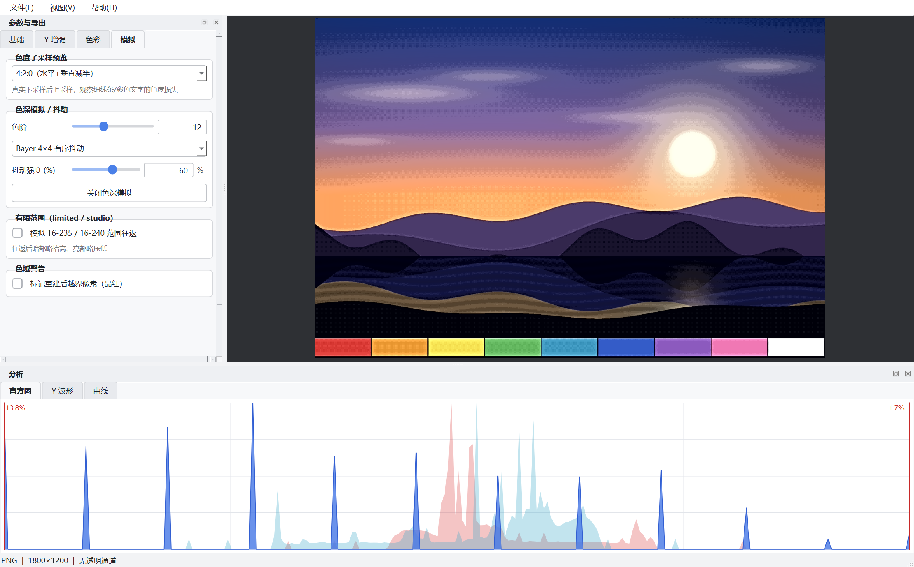
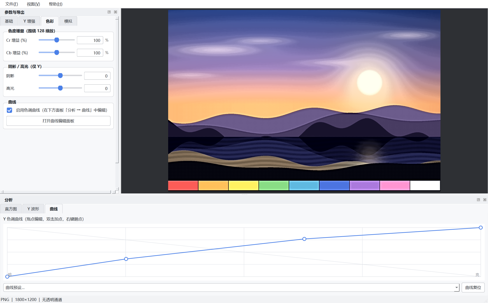
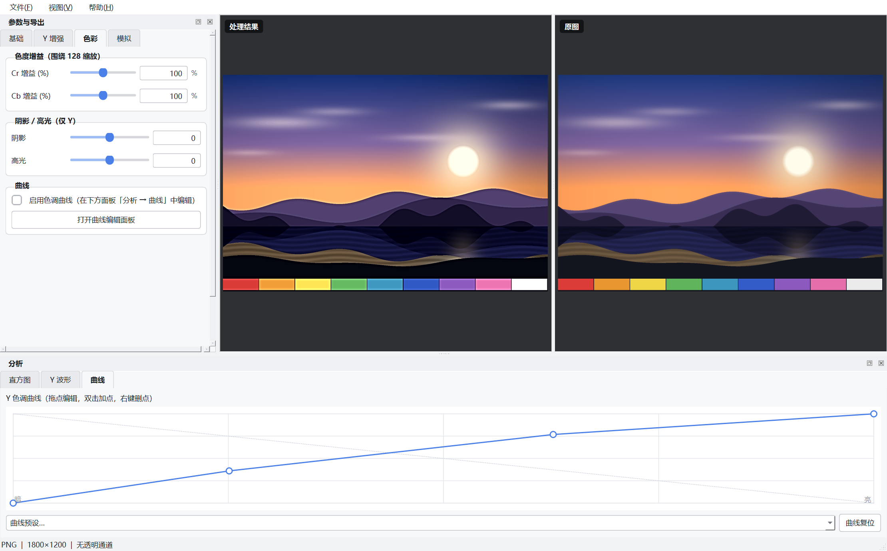
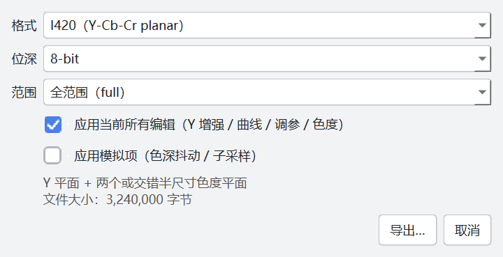

# YCrCb 图像转换工具

[](https://github.com/zhangrui123456-maker/YCrCb-Tool/releases/latest)
[](https://github.com/zhangrui123456-maker/YCrCb-Tool/releases)
[](https://github.com/zhangrui123456-maker/YCrCb-Tool/releases/latest)



面向 **印前制版预处理** 与 **YUV 算法调试** 的 Windows 桌面工具。打开图片 → 转换为 YCrCb（BT.601 / BT.709 / BT.2020）→ 实时分析与编辑 → 导出图像、YUV 原始数据或曲线 LUT。

> 🌟 点一下右上角的 Star，主页就能收到软件更新通知了哦~

---

## 功能

### 转换与显示
- 打开 **PNG / JPEG / BMP / WebP / TIFF / GIF**，支持 EXIF 方向校正与拖拽打开
- 色彩标准：**BT.601 / BT.709 / BT.2020**，全范围 / 有限范围
- 显示模式：重建彩色、Y / Cr / Cb 单通道、通道伪彩色、原图
- 亮度、对比度、饱和度、色相调整（在 YCrCb 空间完成）
- 按住 **空格键** 临时查看原图，松开恢复
- **并排对比**（`Ctrl+D`）：处理结果与原图左右并排，缩放/平移联动
- 功能栏可显示/隐藏（`Ctrl+1` / `Ctrl+2`）、可拖动、可分离为独立窗口，「视图 → 重置布局」一键还原

### Y 增强（只改亮度，色度数学上原样不动）
- **自动对比度**：两端各掐掉 0–10% 极值后拉满量程
- **USM 锐化**：半径 / 强度 / 阈值可调，抑制噪点放大
- **局部对比度 Clarity**：大半径弱锐化，拉开中等尺度层次

### 色彩调整
- **Cr / Cb 独立增益**：快速校正偏色
- **阴影 / 高光** 分离调整
- **色调曲线**：拖拽控制点，内置柔/中/强 S 曲线与提亮/压暗预设，可导出 `.cube` LUT

### 模拟与质检
- **色度子采样** 实时预览：4:4:4 / 4:2:2 / 4:2:0
- **色深模拟 + 抖动**：Bayer 4×4 / 8×8、随机噪声
- **有限范围**（16-235 / 16-240）往返模拟
- **色域越界警告**：越界像素以品红标记

### 分析
- **三通道直方图**：悬停查看各级占比，0/255 堆积红标
- **Y 波形图**
- 像素悬停实时显示 **RGB / YCrCb / YUV** 数值与字节偏移

### 导出
- **图像**：PNG / JPEG / BMP / WebP / TIFF（质量可调，透明通道处理）
- **YUV 原始数据**：I420 / YV12 / NV12 / NV21 / I444 / I422 / YUY2 / UYVY，支持 8 / 10-bit、全 / 有限范围
- **三通道灰度图**、**曲线 LUT**（.cube）、**直方图 PNG**
- **批量处理**：对文件夹内全部图片应用当前设置导出（带进度与取消）
- **参数预设**：保存 / 加载 JSON

## 截图

**基础界面与直方图**


**Y 增强与 Y 波形**



**模拟：4:2:0 子采样 + 色深抖动**



**色调曲线编辑**



**并排对比（处理结果 / 原图）**



**YUV 原始数据导出**



## 下载

前往 [**GitHub Releases**](https://github.com/zhangrui123456-maker/YCrCb-Tool/releases/latest) 下载最新的 `YCrCb工具-v2.2.0.exe`。

- 单文件免安装，双击即可运行，无需安装 Python
- 适用于 **Windows 10 / 11 64 位**
- 首次运行如出现 SmartScreen 提示，点「更多信息 → 仍要运行」即可

## 使用方法

1. 双击 `YCrCb工具.exe` 启动（也可以把图片拖进窗口，或用命令行 `YCrCb工具.exe 图片路径` 直接打开）
2. 左侧「基础」页选择色彩标准与显示模式，拖动亮度 / 对比度 / 饱和度滑块实时预览
3. 在「Y 增强」「色彩」「模拟」页继续调整；底部「分析」栏查看直方图、波形和曲线
4. 按住空格对比原图，`Ctrl+D` 并排对比，`Ctrl+滚轮` 缩放、拖拽平移
5. 「文件 → 导出图像 / 导出 YUV 原始数据…」保存结果；批量处理用 `Ctrl+B`
6. 调好的参数可通过「保存预设」存成 JSON，下次一键加载

**常用快捷键**

| 快捷键 | 功能 |
| --- | --- |
| `Ctrl+O` | 打开图片 |
| `Ctrl+S` | 导出图像 |
| `Ctrl+B` | 批量处理文件夹 |
| `Ctrl+D` | 并排对比 |
| `Ctrl+1` / `Ctrl+2` | 显示/隐藏参数栏 / 分析栏 |
| `F` | 适应窗口 |
| `空格`（按住） | 临时查看原图 |

## FAQ

**Q：为什么调整 Y 增强后颜色看起来没变？**
A：Y 增强只作用于亮度通道，Cr/Cb 保持原样，这是有意设计——避免锐化和对比度操作引入色偏。

**Q：导出的 YUV 文件播放器打不开？**
A：YUV 是裸数据，没有文件头。播放时需手动指定分辨率、像素格式和位深，例如 ffplay：

```bash
ffplay -f rawvideo -pixel_format yuv420p -video_size 1920x1080 output.yuv
```

**Q：4:2:0 预览为什么有彩色边缘？**
A：这是色度下采样的真实损失，正好用来评估细线条、彩色文字在视频编码后的表现。

**Q：支持 Linux / macOS 吗？**
A：界面基于 PySide6，源码理论上跨平台可运行，但目前只提供 Windows 打包版本与测试。

## 换算公式（BT.601，8-bit 全范围）

```
Y  =  0.299R + 0.587G + 0.114B
Cr =  0.500R − 0.419G − 0.081B + 128
Cb = −0.169R − 0.331G + 0.500B + 128
```

BT.709：`Y = 0.2126R + 0.7152G + 0.0722B`；BT.2020：`Y = 0.2627R + 0.6780G + 0.0593B`。逆变换由转换矩阵求逆得到。有限范围：`Y' = Y×219/255 + 16`，`C' = C×224/255 + 16`。

## 开发者

**从源码运行**

```bash
pip install -r requirements.txt
python ycrcb_tool.py
```

**文件结构**

| 文件 | 作用 |
| --- | --- |
| `ycrcb_tool.py` | 界面主程序（窗口、面板、导出、批量） |
| `ycrcb_core.py` | 纯 numpy/Pillow 处理核心（转换、增强、曲线、模拟、YUV 打包），无 GUI 依赖 |
| `widgets.py` | 自绘分析控件：直方图、Y 波形、色调曲线编辑器 |
| `test_ycrcb.py` | 自动测试（88 项） |
| `make_icon.py` / `build_exe.py` | 图标生成 / exe 打包 |
| `app.ico` / `version_info.txt` | 应用图标 / 版本资源 |

**测试**

```bash
python test_ycrcb.py
```

覆盖三种标准的往返误差、参数方向、Y 增强（自动对比度 / USM / 色度不变）、曲线、阴影高光、子采样 / 抖动 / 色域、10 种 YUV 格式的尺寸与平面顺序、10-bit、GUI 离屏全流程。

**打包**

```bash
python build_exe.py
```

输出 `dist/YCrCb工具.exe`（PyInstaller 单文件，含图标与版本信息）。

**依赖**：PySide6 · Pillow · NumPy

## 致谢

- [PySide6 / Qt](https://www.qt.io/) — 跨平台 GUI 框架
- [Pillow](https://python-pillow.org/) — 图像读写
- [NumPy](https://numpy.org/) — 数值运算与色彩管线
- [PyInstaller](https://pyinstaller.org/) — 单文件打包

## 许可证

本项目基于 [GNU General Public License v3.0](LICENSE) 发布。

## 问题反馈

遇到 Bug 或有功能建议，欢迎到 [Issues](https://github.com/zhangrui123456-maker/YCrCb-Tool/issues) 反馈。
